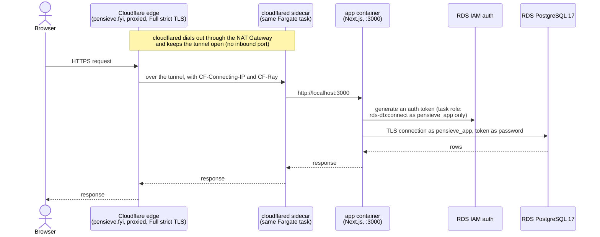
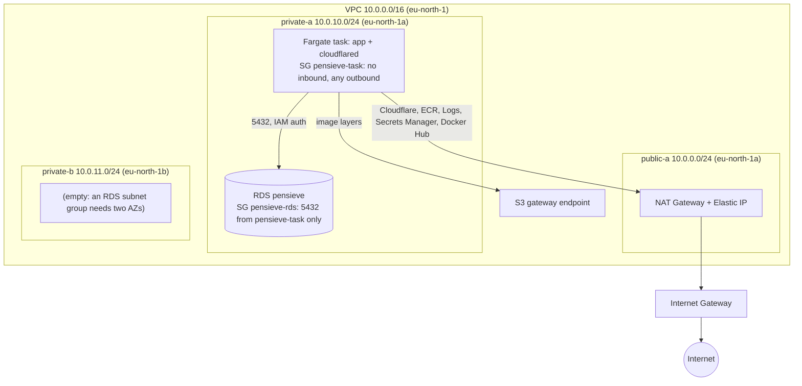
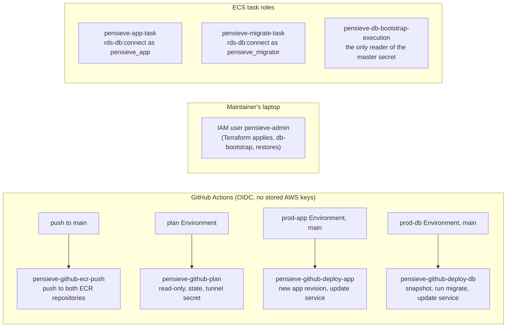

# AWS Architecture

Production runs in one AWS account in `eu-north-1`, defined by two Terraform configurations. `infra/bootstrap` is applied once from the maintainer's laptop and holds what everything else depends on: Terraform state, the GitHub OIDC trust and CI roles, the audit trail and the log bucket. `infra/prod` holds the running system. Cloudflare sits in front, and there's no load balancer and no inbound port anywhere.

## Request path

A browser reaches the app only through Cloudflare. The `cloudflared` sidecar in the app's task dials out to Cloudflare and holds the tunnel open, so nothing on the internet can open a connection to the task. The app reaches PostgreSQL with short-lived IAM tokens, never a password.

The tunnel's ingress sends `pensieve.fyi` to `http://localhost:3000`, and everything else gets a 404. `cloudflared` starts only once the app container passes its health check (`/api/health`, which checks the database too). Both containers are essential, so either one dying replaces the task.

## Network

- Only the NAT Gateway lives in the public subnet. The task and RDS run in `eu-north-1a`, so there's no cross-AZ traffic. The second private subnet is there only because an RDS subnet group needs two AZs.
- The task has no public address and its security group accepts nothing inbound. RDS accepts Postgres only from the task's security group. The VPC's default security group has no rules.
- The S3 gateway endpoint is free, and ECR serves image layers from S3, so image pulls skip the NAT's per-GB charge.

## Compute and data

- **ECS:** one cluster and one service, `pensieve`, on Fargate ARM64 with 0.25 vCPU and 1 GB per task. Deployments go from 0% to 100% healthy (the old task stops before the new one starts), with the circuit breaker rolling back a revision that never turns healthy. The service ignores later Terraform changes to its task definition and desired count: the deploy workflows own them.
- **Task families:** `pensieve-app` (the app and its `cloudflared` sidecar), `pensieve-migrate` (the DB image's migrator, run as a one-off task by `deploy-db`) and `pensieve-db-bootstrap` (the DB image's roles-and-grants bootstrap, run only by the maintainer's local script).
- **RDS:** PostgreSQL 17 on `db.t4g.micro`, single-AZ, 20 GB gp3 growing to 50 GB, encrypted. IAM authentication is on, and the master password is generated and rotated by RDS in Secrets Manager, never in Terraform state. 35 days of point-in-time recovery, deletion protection, a final snapshot on delete, and retained automated backups. A parameter group logs connections and pgaudit's `role` and `ddl` classes.
- **ECR:** `pensieve` (the app image) and `pensieve-db` (the DB image). Tags are immutable except `main`. Lifecycle rules keep the last 50 `sha-*` images and expire untagged ones after a day.
- **Secrets Manager:** the Cloudflare tunnel token, which ECS injects into `cloudflared` with the app's execution role, and the RDS master secret.

## The two images

| | App image (`pensieve`) | DB image (`pensieve-db`) |
| --- | --- | --- |
| Built by | `ci.yml` (`image / build`) | `db.yml` (`db-image`) |
| Contains | Next.js standalone server, healthcheck | `drizzle/`, the migrator and bootstrap entrypoints, the RDS CA bundle |
| Runs as | the `pensieve-app` service | one-off `pensieve-migrate` and `pensieve-db-bootstrap` tasks |
| Database user | `pensieve_app` (rows only) | `pensieve_migrator` (schema owner); the bootstrap as the master |
| Signed by | `ci.yml@refs/heads/main` | `db.yml@refs/heads/main` |

Both are distroless Node, arm64, signed keylessly with cosign and published with a signed CycloneDX SBOM. Every deploy verifies the signature by digest before using an image. The [Deployable Image](/architecture/deployable-image) page covers how they're built.

## Roles

- Each GitHub role trusts exactly one context, matched on the token's `sub` (built from the repository's immutable IDs) and, for the deploy roles, the `main` ref too.
- `deploy-app` can register only app revisions and point the service at them. `deploy-db` can also register migrate revisions and run them as one-off tasks. Each can pass only those families' roles. No GitHub role can run the bootstrap family or pass its role, so CI can never reach master power over the database, even indirectly.
- `deploy-db` may delete only `pensieve-predeploy-*` snapshots. Restores and Terraform applies are the admin user's alone.
- A hand-made `pensieve-auditor` user (read-only and SecurityAudit, for ScoutSuite) can read the state and log buckets' configuration, but not their objects.

## Security logging

For investigating after an incident, not alerting: nothing here pages anyone. The [incident runbook](/runbooks/incidents) says which question each source answers.

| Source | Where it goes | Kept | Queried with |
| --- | --- | --- | --- |
| CloudTrail (management events, state-bucket and log-bucket object calls) | log bucket, `cloudtrail/` | 90 days | Athena table `cloudtrail` |
| VPC Flow Logs (all traffic, NAT-transparent fields) | log bucket, `vpc-flow/` | 30 days | Athena table `vpc_flow` |
| Route 53 Resolver query logs | log bucket, `resolver/` | 30 days | Athena table `resolver` |
| RDS server log (connections, pgaudit) and IAM auth failures | `/aws/rds/instance/pensieve/{postgresql,iam-db-auth-error}` | 30 days | CloudWatch Logs Insights |
| App, `cloudflared`, migrate and bootstrap containers | `/ecs/pensieve-*` | 30 days | CloudWatch Logs Insights |
| Athena query results | log bucket, `athena-results/` | 7 days | — |

The log bucket, `pensieve-logs-<account>`, is versioned and TLS-only, and only the admin user can read it. AWS services can only write, each to its own prefix. Flow and Resolver logs, and the RDS exports, each have an off switch for cost: a `plan` Environment variable read by Terraform (see `infra/prod/README.md`, "Logging switches").

## Cost

Spec 11 priced the design at about **$62 a month**, almost all of it fixed. The largest item is the NAT Gateway with its Elastic IP, at about $37. The rest is the Fargate task, the RDS instance and its storage, Secrets Manager and the state bucket's KMS key. Usage-driven costs (NAT processing, CloudWatch ingestion, transfer) were estimated at under $1 a month for one or two users. The network logs and RDS exports add ingestion and storage by volume, which is why they can be switched off.

The design rejected cheaper options deliberately. A Tunnel costs nothing where an ALB with mTLS would cost about $25. A task with a public IP and no inbound rules would have cost about $28 a month in total, but the private subnet behind a NAT was chosen instead. A monthly AWS Budget emails the maintainer at $10 actual and $20 forecast. Both are expected to fire every month, as a "something is running" signal.
