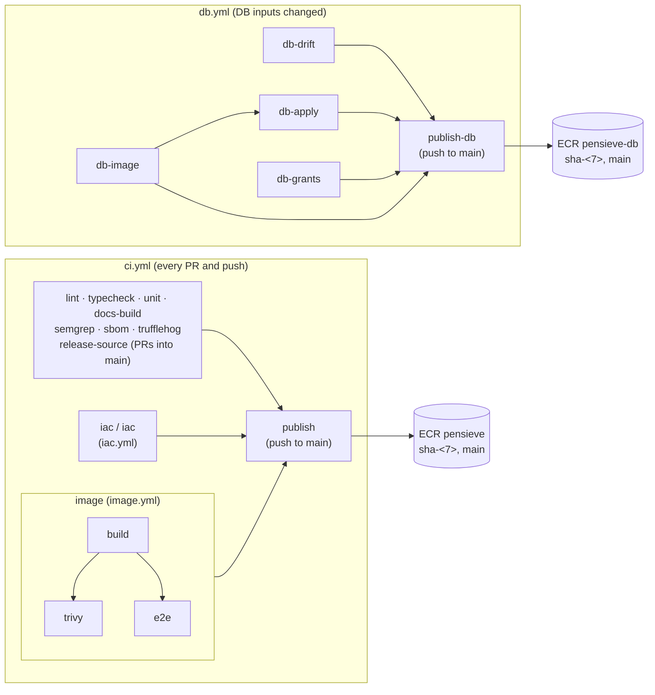

# CI Pipeline

Two workflows check every change into `develop` and `main`. `ci.yml` gates everything and runs on every pull request and push. `db.yml` checks the database image and its migrations, and runs only when a database input changes. A push to `main` is a release: each workflow then publishes its image, signed, to Amazon ECR. Deploying a published image is a separate, manually dispatched step (see the [deploy runbook](/runbooks/deploy)).

## `ci.yml`: the gates

`ci.yml` is a short orchestrator. Most jobs are inline. Two self-contained areas are reusable workflows that it calls: the infrastructure checks (`.github/workflows/iac.yml`, called by the `iac` job) and the image pipeline (`.github/workflows/image.yml`, called by the `image` job). Every job runs on every change: nothing is path-filtered.

| Check | What it does | Fails on |
| --- | --- | --- |
| `lint` | ESLint, actionlint over the workflows, hadolint over both Dockerfiles, shellcheck over `.github/scripts/` and `scripts/` | Any finding |
| `typecheck` | `next typegen` and `tsc --noEmit` | Any type error |
| `unit` | Vitest against a `postgres:17-alpine` service container, after `npm run db:migrate` proves the drizzle-kit path | Any failing test |
| `docs-build` | Builds this VitePress site | A build error |
| `semgrep` | SAST and supply-chain scan. With the `SEMGREP_APP_TOKEN` secret, `semgrep ci` and the Semgrep dashboard's policies decide what blocks. Fork and Dependabot PRs fall back to fixed rulesets | A blocking finding |
| `sbom` | A CycloneDX SBOM of the production dependencies (`npm sbom --omit dev`) | Generation failing |
| `trufflehog` | Secrets in the commits under test. A release scans the release's files instead of `main`'s whole range | Any verified, unknown or unverified finding |
| `release-source` | PRs into `main` only: the head must be this repository's `develop` | Any other head |
| `iac / iac` | `terraform fmt`, `validate`, `test` (mocked providers) and tflint over every config in `infra/`. On PRs from this repository's branches, a read-only plan of prod in the `plan` Environment | Any check failing, or the plan erroring |
| `image / build` | Builds the arm64 app image, then Trivy's secret scan over every layer and the image config | Any embedded secret |
| `image / trivy` | Trivy's vulnerability scan of the built image, with `.trivyignore`'s dated exceptions | A fixable vulnerability of any severity |
| `image / e2e` | The Playwright suite against the built image itself, not `next dev` | Any failing spec |

A job that calls a reusable workflow reports one check per called job, named `<caller> / <callee>`.

**What blocks a merge.** The `main` ruleset requires each check above by its name, with "branches must be up to date". `develop`'s ruleset requires no checks: a failing gate shows on the PR, and the maintainer's review stops it. Adding or renaming a gate means updating `protect-main`'s required checks too, or the new name never blocks. CodeQL's default setup also runs (JavaScript/TypeScript and Actions), and GitHub adds a "Code scanning results" check per SARIF-uploading tool. Neither is required.

## `db.yml`: the database image

`db.yml` runs on the same branches, but only when one of the DB image's inputs changes: `drizzle/`, `db/`, `src/db/`, `certs/`, `drizzle.config.ts`, the dependency files, `tsconfig.json` or the workflow itself. Its checks aren't required by any ruleset: a required check whose workflow never triggered would block every app-only PR. A failing run still shows on the PR.

| Job | What it does |
| --- | --- |
| `db-drift` | `drizzle-kit generate`, failing if it writes anything: `src/db/schema.ts` changed without a committed migration. No database |
| `db-image` | Builds the arm64 DB image, runs Trivy's secret and vulnerability scans, and writes its SBOM |
| `db-apply` | The image's migrator applies every migration to an empty database. Then the upgrade path: `main`'s migrations (or, on a release, `main` before the push) applied with drizzle-kit, then the image's migrator on top with `ALLOW_BREAKING=true` |
| `db-grants` | The roles-and-grants test: the bootstrap SQL as a stand-in master, the migrations as the migrator, then what the app role can and can't do |

## Where results go

- **Run summaries.** Every job writes one line to its run's summary page (pass or fail, counts, the reason). `iac / iac` adds the prod plan, which never goes to the log or an artifact.
- **Code Scanning.** SARIF from Semgrep (category `Semgrep`), TruffleHog and both images' Trivy secret scans (`Secrets`), and both images' Trivy vulnerability scans (`Container SCA`), plus CodeQL's own. Uploads happen even when the scan fails the job, so findings survive the failure they cause.
- **Artifacts.** The app image tarball (`pensieve-image`, 1 day as the hand-off to later jobs, 14 days on `develop` pushes), the SBOM (`sbom-<sha>`, 90 days), the DB image and its SBOM (`pensieve-db-image`, 1 day; `pensieve-db-sbom`, 90 days), and the Playwright report on an e2e failure (3 days).

## Publishing

On a push to `main`, after every job of its workflow has passed:

- **`publish`** (`ci.yml`) pushes the scanned app image tarball to the `pensieve` repository as `sha-<7>`, without rebuilding it. It signs it with keyless cosign, attaches the SBOM as a signed attestation, and moves `main`. A release that didn't change the app produces the same image config, so nothing is pushed. It stays a top-level job of `ci.yml`, because its signing identity is `ci.yml@refs/heads/main`, which the deploy scripts verify.
- **`publish-db`** (`db.yml`) does the same for the DB image in `pensieve-db`, with identity `db.yml@refs/heads/main`. It runs only on releases that touch a DB input, and each such release publishes, since the DB image isn't built reproducibly.

Both use the shared `.github/actions/publish-image` action and authenticate as the ECR push role, which only `main` can assume. The [Deployable Image](/architecture/deployable-image#publishing-to-ecr) page has the mechanics.
