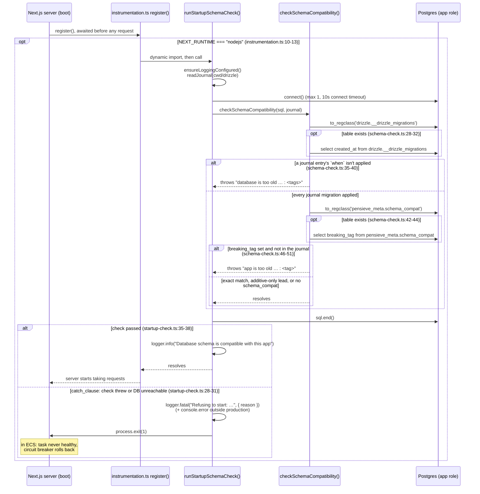

# Startup Schema Check

Covers what the app does once, at boot, before it serves any request: check
that the database's schema is one this build can run on. Entry point:
`src/instrumentation.ts` (`register`), which Next.js runs once per server
instance and awaits before handling requests. The work is in
`src/db/startup-check.ts` (`runStartupSchemaCheck`) and
`src/db/schema-check.ts` (`checkSchemaCompatibility`).

The check is **two-sided**. The app image ships only
`drizzle/meta/_journal.json`, the list of migrations it was built with, and
compares it with two things the app role can read (`SELECT` only):

- **Database too old:** every journal migration must be recorded in
  Drizzle's bookkeeping table, `drizzle.__drizzle_migrations`. A row's
  `created_at` is its journal entry's `when`, which is how the two are
  matched. This catches an app deployed before its migration.
- **App too old:** `pensieve_meta.schema_compat` holds the tag of the newest
  *breaking* migration ever applied, written by the DB image's migrator. If
  the journal doesn't contain that tag, the app predates a breaking change.
  This catches an older app (e.g. a circuit-breaker rollback) restarted on a
  newer, incompatible schema.

A database **ahead only by additive migrations** passes: those don't change
`schema_compat`, and the first side only asks that the journal's own
migrations are applied.

When `schema_compat` doesn't exist, no breaking migration is on record, so
only the first side applies. That's the normal state for local development,
unit CI and e2e, which migrate with `drizzle-kit` and never create
`pensieve_meta`. In AWS the DB image's migrator creates the table in the
same transaction as its first batch, so it can't be missing there while the
migrations are applied.

Any failure, including a database it can't reach within 10 seconds, **exits
the process with code 1** after logging the reason (a `FATAL` JSON line in
production; also printed to the terminal under `next dev`). Only the error's
message is logged, since a driver error can carry connection details. In
ECS the task then never turns healthy, and the deployment circuit breaker
rolls back. The check runs only in the Node.js runtime and isn't run during
`next build`.

